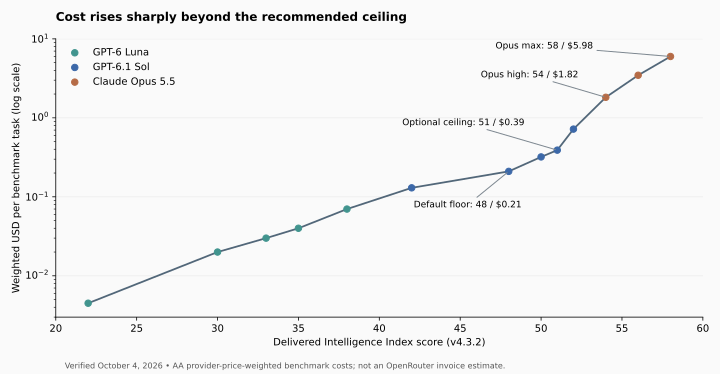

# AI model selection — October 7, 2026 (revision 3)

**API default floor:** MiMo-V2.6-Pro / thinking enabled, score 46.324, $0.133223 per AA task. **Optional ceiling:** GPT-6.1 Sol / xhigh, score 51.038, $0.392861.

This same-day launch revision adds Claude Haiku 5.5 xhigh to the paid frontier after verifying five independent AA score/cost pairs, official release status, supported efforts and exact OpenRouter routing metadata. The other four Haiku efforts are dominated. Coverage now inventories 467 OpenRouter entries and 502 AA releases. The API floor remains MiMo Pro; the ceiling remains Sol xhigh. Earlier October 7 data is preserved in Git history at bfc6433ee119820ad626689dbfb891924b56428c.

AA Intelligence Index v4.3.2 measures broad capability, not percentage knowledge. The cost is AA's weighted benchmark-task cost calculated from measured token use and published prices, not an OpenRouter invoice forecast or a per-prompt spending cap. Each source's actual verification time is retained in latest.json; AA does not expose exact evaluation completion dates. SciCode and CritPt remain marked under review.

Calculations now use AA's underlying publicly embedded numerical values instead of rounded cards. Precise thresholds are useful for reproducible lookup; they do not imply statistically significant differences between close scores. No benchmark version changed.

## Applications: least cost for a capability target

The ranges below use unrounded published scores. Cost display is rounded to six decimals; exact score and cost numbers, budget intervals, pinned provider/revision, and request settings are in latest.json. For targets above the highest observed score there is no eligible choice. Use the selector rather than rounding targets. Native thinking toggles are represented as enabled=true; effort is null only in metadata and is omitted from the request.

| Minimum-score range | OpenRouter request.model | Reasoning control | Delivered score | USD / AA task |
|---|---|---|---:|---:|
| [0, 21.5261980080866] | `openai/gpt-6-luna` | `effort=low` | 21.526 | $0.004517 |
| (21.5261980080866, 29.9251773515762] | `openai/gpt-6-luna` | `effort=medium` | 29.925 | $0.017477 |
| (29.9251773515762, 32.9282054150837] | `openai/gpt-6-luna` | `effort=high` | 32.928 | $0.029032 |
| (32.9282054150837, 34.5587320217785] | `openai/gpt-6-luna` | `effort=xhigh` | 34.559 | $0.042184 |
| (34.5587320217785, 37.8843590141754] | `xiaomi/mimo-v2.6-flash` | `enabled=true` | 37.884 | $0.062315 |
| (37.8843590141754, 38.1245186869738] | `openai/gpt-6-luna` | `effort=max` | 38.125 | $0.067823 |
| (38.1245186869738, 41.2489304677024] | `anthropic/claude-haiku-5.5` | `effort=xhigh` | 41.249 | $0.123786 |
| (41.2489304677024, 42.0835618555848] | `openai/gpt-6.1-sol` | `effort=low` | 42.084 | $0.130752 |
| (42.0835618555848, 46.3242065310383] | `xiaomi/mimo-v2.6-pro` | `enabled=true` | 46.324 | $0.133223 |
| (46.3242065310383, 47.7833271274065] | `openai/gpt-6.1-sol` | `effort=medium` | 47.783 | $0.213701 |
| (47.7833271274065, 50.2377777519769] | `openai/gpt-6.1-sol` | `effort=high` | 50.238 | $0.319144 |
| (50.2377777519769, 51.0377679093761] | `openai/gpt-6.1-sol` | `effort=xhigh` | 51.038 | $0.392861 |
| (51.0377679093761, 51.8332597011541] | `openai/gpt-6.1-sol` | `effort=max` | 51.833 | $0.724167 |
| (51.8332597011541, 53.5831959822067] | `anthropic/claude-opus-5.5` | `effort=high` | 53.583 | $1.822505 |
| (53.5831959822067, 55.9873505840139] | `anthropic/claude-opus-5.5` | `effort=xhigh` | 55.987 | $3.459110 |
| (55.9873505840139, 57.6223698102963] | `anthropic/claude-opus-5.5` | `effort=max` | 57.622 | $5.982012 |

## Haiku 5.5 launch verification

Official launch date: October 7, 2026. Callable ID: `anthropic/claude-haiku-5.5`; canonical revision: `anthropic/claude-haiku-5.5-20261007`. Supported efforts: low, medium, high, xhigh, max; default medium. Short-context token rates: $0.10 input/$0.50 output per million; above 100K input tokens, $0.50/$2.50. Token prices are separate from the AA task costs below.

| reasoning.effort | OpenRouter request.model | Delivered AA score | USD / AA task | Frontier status |
|---|---|---:|---:|---|
| `low` | `anthropic/claude-haiku-5.5` | 29.449 | $0.024459 | Dominated by openai/gpt-6-luna@medium |
| `medium` | `anthropic/claude-haiku-5.5` | 34.465 | $0.047031 | Dominated by openai/gpt-6-luna@xhigh |
| `high` | `anthropic/claude-haiku-5.5` | 37.824 | $0.079427 | Dominated by xiaomi/mimo-v2.6-flash@thinking-enabled |
| `xhigh` | `anthropic/claude-haiku-5.5` | 41.249 | $0.123786 | Retained |
| `max` | `anthropic/claude-haiku-5.5` | 43.395 | $0.212770 | Dominated by xiaomi/mimo-v2.6-pro@thinking-enabled |

Only xhigh enters the actionable frontier: targets (38.1245186869738, 41.2489304677024] and AA-task budgets [$0.12378561092096102, $0.13075190869859377). Exact values are from AA publicly embedded model records and are not estimates. The rounded model cards and release summary agree after refresh. No alternate fallback model is inferred: AA labels these Default Fallback, but official Anthropic docs explicitly say Haiku 5.5 has no server-side fallback and default leaves declined requests declined. Adaptive thinking is required at xhigh/max; the standard first-party Anthropic endpoint is pinned and gateway fallback disabled. This mapping is documentation/metadata verified, not a paid generation test.

Upgrading Luna max to Haiku xhigh adds 3.124412 points for $0.055963 (+82.51%): $0.017911 per point. Haiku xhigh to Sol low adds 0.834631 points for $0.006966 (+5.63%): $0.008347 per point. Moving directly from Haiku xhigh to the MiMo Pro floor adds 5.075276 points for $0.009438 (+7.62%); the general-purpose floor/ceiling recommendation stays unchanged.

Launch-day caveats: exact evaluation completion dates and speed measurements are unavailable; SciCode and CritPt remain under review. The batch variant has discounted token prices but no separately verified matching AA task costs, so it is pending and excluded. Anthropic also announced lower Sonnet cache-read prices; OpenRouter still lists the earlier price at the check. Existing AA task costs have not been recomputed from token prices or vendor typical-agentic savings claims.

For every paid row: provider.require_parameters=true, allow_fallbacks=false, and one exact provider tag. Xiaomi uses xiaomi/fp8; OpenAI uses openai; Anthropic uses anthropic. OpenAI tools use the Responses endpoint; other retained rows use Chat Completions. Canonical revision slugs and endpoint timestamps are verified in latest.json. Metadata checks succeeded; no paid generation test was run.

For MiMo, use provider sampling defaults, preserve reasoning_details during tool turns, and allocate enough output for thinking and answers. Xiaomi's first-party documentation states that named effort values all enable identical thinking, so they are not additional benchmark configurations. Official launch/update is September 22; AA/OpenRouter list September 21. The discrepancy is recorded, and the pinned revision is 20260921.

## Applications: most capability within a cost budget

The same frontier supports the inverse question. Costs below are AA benchmark-task budgets, not production invoice estimates. Budget intervals are lower-inclusive and upper-exclusive; the highest interval has no upper limit.

| Example budget, USD / AA task | Best observed choice within budget | Score | Observed cost |
|---:|---|---:|---:|
| $0.01 | GPT-6 Luna / low | 21.526 | $0.004517 |
| $0.03 | GPT-6 Luna / high | 32.928 | $0.029032 |
| $0.07 | GPT-6 Luna / max | 38.125 | $0.067823 |
| $0.14 | MiMo-V2.6-Pro / thinking enabled | 46.324 | $0.133223 |
| $0.25 | GPT-6.1 Sol / medium | 47.783 | $0.213701 |
| $0.40 | GPT-6.1 Sol / xhigh | 51.038 | $0.392861 |
| $1.00 | GPT-6.1 Sol / max | 51.833 | $0.724167 |
| $2.00 | Claude Opus 5.5 / high | 53.583 | $1.822505 |
| $4.00 | Claude Opus 5.5 / xhigh | 55.987 | $3.459110 |
| $6.00 | Claude Opus 5.5 / max | 57.622 | $5.982012 |

**Limited free opt-in:** google/gemma-4-31b-it:free with reasoning.enabled=true and provider.only=[google-ai-studio] delivers AA score 14.6689500745828 at measured $0/task. Both AA and the verified first-party gateway route are free; no token-price substitution was made. The catalog default is reasoning off, so enabling it is required. It serves targets [0,14.6689500745828] and budgets [0,0.004516607569410252) when explicitly opted in. Free availability/limits are not a production entitlement. Managed Google quantization is undisclosed; no third-party replacement is permitted. Default paid selection remains available at these score targets.

Other zero-cost release bounds do not automatically become zero-cost OpenRouter routes: K2 Horizon and Ling Tiny have no verified exact route; Command A+ has a paid gateway candidate; North Mini Code's lower zero-cost score is dominated by free Gemma. Pending configurations remain outside selectors.

## Marginal costs and breakpoints

The suggested floor is a workload-dependent high-capability default, not a universal optimum. MiMo Pro saves 37.66% versus Sol medium while delivering 1.459121 fewer points. The cost-capability tradeoff may change after measuring failures, latency, retry cost and review time on your workload.

High-capability default candidate: upgrading Sol low to MiMo Pro adds 4.240645 points for $0.002471/task (+1.89%). The next upgrade, Sol medium, adds 1.459121 points for $0.080478 (+60.41%): $0.055155 per point, 94.64x the preceding marginal cost. MiMo Pro costs 37.66% less than Sol medium while delivering 1.459121 fewer index points. Validate coding reliability, latency, locale and tools on the application workload.

Optional higher-capability ceiling before Sol max: xhigh to max adds 0.795492 points for $0.331306 (+84.33%), or $0.416479/point, 4.5197x the preceding marginal rate. Higher-priced Opus can still be worthwhile when failures or human review cost more than model calls.

Early local bends also matter: Luna high to xhigh costs about 2.10x the preceding dollars per point, but the next MiMo Flash step improves that rate. MiMo Flash to Luna max pays $0.005508 for only 0.240160 points (3.79x the preceding marginal rate); Haiku xhigh now bridges Luna max and Sol low; Sol low to MiMo Pro remains exceptionally inexpensive. These local bends are not persistent reasons to stop below the recommended high-capability floor. For very light tasks, keep the cheapest model that passes task-specific success checks.

| Upgrade to | Point gain | Added USD/task | Cost increase | Added USD/point | Versus prior USD/point |
|---|---:|---:|---:|---:|---:|
| GPT-6 Luna / medium | 8.398979 | $0.012960 | 286.95% | $0.001543 | — |
| GPT-6 Luna / high | 3.003028 | $0.011555 | 66.11% | $0.003848 | 2.49x |
| GPT-6 Luna / xhigh | 1.630527 | $0.013152 | 45.30% | $0.008066 | 2.10x |
| MiMo-V2.6-Flash / thinking enabled | 3.325627 | $0.020131 | 47.72% | $0.006053 | 0.75x |
| GPT-6 Luna / max | 0.240160 | $0.005508 | 8.84% | $0.022936 | 3.79x |
| Claude Haiku 5.5 / xhigh | 3.124412 | $0.055963 | 82.51% | $0.017911 | 0.78x |
| GPT-6.1 Sol / low | 0.834631 | $0.006966 | 5.63% | $0.008347 | 0.47x |
| MiMo-V2.6-Pro / thinking enabled | 4.240645 | $0.002471 | 1.89% | $0.000583 | 0.07x |
| GPT-6.1 Sol / medium | 1.459121 | $0.080478 | 60.41% | $0.055155 | 94.64x |
| GPT-6.1 Sol / high | 2.454451 | $0.105444 | 49.34% | $0.042960 | 0.78x |
| GPT-6.1 Sol / xhigh | 0.799990 | $0.073717 | 23.10% | $0.092147 | 2.14x |
| GPT-6.1 Sol / max | 0.795492 | $0.331306 | 84.33% | $0.416479 | 4.52x |
| Claude Opus 5.5 / high | 1.749936 | $1.098338 | 151.67% | $0.627644 | 1.51x |
| Claude Opus 5.5 / xhigh | 2.404155 | $1.636605 | 89.80% | $0.680741 | 1.08x |
| Claude Opus 5.5 / max | 1.635019 | $2.522902 | 72.93% | $1.543041 | 2.27x |

Dollars per index point is descriptive: equal index intervals need not deliver equal practical value. Pay above the ceiling for difficult architecture, correctness-critical debugging or research when better success rates outweigh incremental call cost. Subscription harnesses and application tools can change those success rates.

## Building through subscriptions

Your four services are known; exact personal tiers and account pickers are unknown. These are conditional starting recommendations, not proof of your entitlement. API scores and benchmark-task costs are deliberately null for these app/harness combinations; included allowance is not priced as $0 per task. Monthly subscription price alone cannot establish cost per successful building task.

| Service | Routine default | Escalation | Quota-saving choice | Eligibility / limitation |
|---|---|---|---|---|
| OpenAI | GPT-6.1 Sol; {"reasoning_effort":"medium","ui_label":"Medium","speed":"Standard"} | GPT-6.1 Sol; {"reasoning_effort":"xhigh","ui_label":"Extra High","speed":"Standard"} | GPT-6 Luna; {"reasoning_effort":"high","ui_label":"High","speed":"Standard"} | Plus, Pro, Business, Enterprise or Edu launch access; client/rollout dependent; Enterprise/Edu admin must enable. Not Chat; Free/Go excluded at launch. |
| Claude | Claude Sonnet 5.5; {"effort":"high","ui_label":"High","thinking":"always_on_in_Claude"} | Claude Opus 5.5; {"effort":"xhigh","ui_label":"Extra high","thinking":"always_on"} | Claude Haiku 5.5; {"effort":"low","ui_label":"Low","thinking":"always_on_in_Claude"} | Pro/Max subscription login covers Claude Code; use /model to check exact account access. Team/Enterprise policy may restrict model or effort. |
| Grok | Grok 4.7; {"selection":"documented default model","effort":null,"ui_to_api_effort_mapping":"unverified","speed":"standard"} | Grok account higher-reasoning mode; {"selection":"only the higher-reasoning option actually exposed by the account","effort":null,"ui_to_api_effort_mapping":"unverified"} | Grok 4.7 standard mode; {"selection":"standard rather than Fast","effort":null,"ui_to_api_effort_mapping":"unverified"} | Available in Grok Build; included allowance depends on exact account/plan. |
| Gemini | Gemini 3.8 Flash; {"ui_thinking":"Standard where exposed","api_effort_mapping":null} | Gemini 3.8 Flash with Extended thinking; {"ui_thinking":"Extended where exposed","api_effort_mapping":null} | Gemini Flash-Lite; {"ui_thinking":"Standard where exposed","api_effort_mapping":null} | Official launch: Gemini app for Google AI Pro/Ultra; model availability differs by surface, region and account. |

Use GPT-6.1 Sol medium or Sonnet high in the building tool connected to the project. Escalate inside that service when a hard step stalls. Grok Build and Gemini/Antigravity provide alternative harnesses and useful second opinions; exact consumer UI-to-API effort mapping is not established. Gemini Deep Think and OpenAI Ultra are parallel/multi-agent modes and cannot inherit single-model API scores. Argon remains restricted; it is not assumed available through a normal Google subscription.

**OpenAI usage:** Work and Codex share allowances. Fast uses 2.5x included allowance relative to Standard. Included tasks vary by context, effort and tools; use account dashboard. API rates are separate.

**Claude usage:** Claude and Claude Code share plan limits; higher effort uses more quota. An ANTHROPIC_API_KEY can cause API billing instead of subscription usage. Personal tier not known.

**Grok usage:** Consumer FAQ describes a shared weekly pool and paid extra usage. Bot launch docs describe its own usage pool, so keep Bot separate and check its dashboard; do not assume identical accounting. API credits are separate. Exact consumer reasoning control not verified.

**Gemini usage:** Models/thinking consume differing allowance. Generic Help still lists Gemini 3 families while September launch explicitly grants 3.8 Flash to Pro/Ultra; prefer launch for exact revision, Help for controls. Gemini 4 Argon is restricted Fairwind rollout, not assumed consumer subscription access.

## Verification, coverage and freshness

latest.json schema 1.1.0 contains the paid frontier, separate limited_free_configurations, subscription_recommendations, all marginal steps, source checks and coverage counts. coverage.json records every catalog entry and AA release screening bound. Release maximum score/minimum cost combinations are optimistic bounds used to rule out potential winners; they are never substituted for exact measured configuration pairs.

There are 52 exact AA records from the original four-lab candidates, Xiaomi candidates and newly verified Haiku 5.5 efforts, all on v4.3.2. Unrelated source timestamps have not been advanced during this targeted launch update. Other catalog entries are explicitly pending or screened dominated; this does not claim full per-effort measurement for all 467 entries. Both selectors reject stale snapshots/rows, revision mismatches, removed routes and missing reasoning/tool parameters. Reports expire for routing after 48 hours. The live catalog and exact provider endpoint are rechecked by the selector before returning a request skeleton.

## Sources

- https://ai.google.dev/gemini-api/docs/changelog
- https://ai.google.dev/gemini-api/docs/models/gemini-3.8-flash
- https://ai.google.dev/gemini-api/docs/pricing
- https://ai.google.dev/gemma/docs/capabilities/thinking
- https://artificialanalysis.ai/articles/benchmarking-gpt-6-astra
- https://artificialanalysis.ai/articles/benchmarking-grok-4-7
- https://artificialanalysis.ai/articles/claude-opus-5-5
- https://artificialanalysis.ai/articles/claude-sonnet-5-5
- https://artificialanalysis.ai/articles/gemini-4-argon-google-top-three-labs
- https://artificialanalysis.ai/articles/gpt-6-1-sol-replaces-gpt-6-sol-after-just-7-days-with-near-astra-intelligence
- https://artificialanalysis.ai/articles/gpt-6-sol-and-luna-push-the-cost-efficiency-frontier
- https://artificialanalysis.ai/methodology/intelligence-benchmarking
- https://artificialanalysis.ai/models
- https://artificialanalysis.ai/models/claude-opus-5-5
- https://artificialanalysis.ai/models/claude-opus-5-5-high
- https://artificialanalysis.ai/models/claude-opus-5-5-low
- https://artificialanalysis.ai/models/claude-opus-5-5-medium
- https://artificialanalysis.ai/models/claude-opus-5-5-xhigh
- https://artificialanalysis.ai/models/claude-sonnet-5-5
- https://artificialanalysis.ai/models/claude-sonnet-5-5-high
- https://artificialanalysis.ai/models/claude-sonnet-5-5-low
- https://artificialanalysis.ai/models/claude-sonnet-5-5-medium
- https://artificialanalysis.ai/models/claude-sonnet-5-5-xhigh
- https://artificialanalysis.ai/models/gemini-3-1-pro-preview
- https://artificialanalysis.ai/models/gemini-3-5-flash-lite
- https://artificialanalysis.ai/models/gemini-3-8-flash
- https://artificialanalysis.ai/models/gemini-3-8-flash-low
- https://artificialanalysis.ai/models/gemini-3-8-flash-medium
- https://artificialanalysis.ai/models/gemma-4-31b
- https://artificialanalysis.ai/models/gpt-6-1-sol
- https://artificialanalysis.ai/models/gpt-6-1-sol-high
- https://artificialanalysis.ai/models/gpt-6-1-sol-low
- https://artificialanalysis.ai/models/gpt-6-1-sol-medium
- https://artificialanalysis.ai/models/gpt-6-1-sol-xhigh
- https://artificialanalysis.ai/models/gpt-6-astra
- https://artificialanalysis.ai/models/gpt-6-astra-high
- https://artificialanalysis.ai/models/gpt-6-astra-low
- https://artificialanalysis.ai/models/gpt-6-astra-medium
- https://artificialanalysis.ai/models/gpt-6-astra-xhigh
- https://artificialanalysis.ai/models/gpt-6-luna
- https://artificialanalysis.ai/models/gpt-6-luna-high
- https://artificialanalysis.ai/models/gpt-6-luna-low
- https://artificialanalysis.ai/models/gpt-6-luna-medium
- https://artificialanalysis.ai/models/gpt-6-luna-non-reasoning
- https://artificialanalysis.ai/models/gpt-6-luna-xhigh
- https://artificialanalysis.ai/models/gpt-6-sol
- https://artificialanalysis.ai/models/gpt-6-sol-high
- https://artificialanalysis.ai/models/gpt-6-sol-low
- https://artificialanalysis.ai/models/gpt-6-sol-medium
- https://artificialanalysis.ai/models/gpt-6-sol-non-reasoning
- https://artificialanalysis.ai/models/gpt-6-sol-xhigh
- https://artificialanalysis.ai/models/grok-4-6
- https://artificialanalysis.ai/models/grok-4-6-low
- https://artificialanalysis.ai/models/grok-4-6-medium
- https://artificialanalysis.ai/models/grok-4-6-xhigh
- https://artificialanalysis.ai/models/grok-4-7
- https://artificialanalysis.ai/models/grok-4-7-high
- https://artificialanalysis.ai/models/grok-4-7-low
- https://artificialanalysis.ai/models/mimo-v2-6-flash
- https://artificialanalysis.ai/models/mimo-v2-6-pro
- https://artificialanalysis.ai/models/mistral-large-4
- https://artificialanalysis.ai/models/releases
- https://artificialanalysis.ai/models/releases/claude-opus-5-5
- https://artificialanalysis.ai/models/releases/claude-sonnet-5-5
- https://artificialanalysis.ai/models/releases/comparisons/gpt-6-1-sol-vs-gpt-6-astra
- https://artificialanalysis.ai/models/releases/gemini-3-8-flash
- https://artificialanalysis.ai/models/releases/gpt-6-1-sol
- https://artificialanalysis.ai/models/releases/gpt-6-luna
- https://artificialanalysis.ai/models/releases/grok-4-7
- https://blog.google/innovation-and-ai/models-and-research/gemini-models/3-8-flash-and-3-8-flash-cyber/
- https://blog.google/innovation-and-ai/models-and-research/gemini-models/gemini-4-argon/
- https://blog.google/innovation-and-ai/technology/ai/google-ai-updates-september-2026/
- https://developers.openai.com/api/docs/changelog
- https://developers.openai.com/api/docs/deprecations
- https://developers.openai.com/api/docs/models/gpt-6-astra
- https://developers.openai.com/api/docs/models/gpt-6-luna
- https://developers.openai.com/api/docs/models/gpt-6-sol
- https://developers.openai.com/api/docs/models/gpt-6.1-sol
- https://docs.mistral.ai/models/mistral-large-4-0
- https://docs.x.ai/developers/grok-4-7
- https://docs.x.ai/developers/release-notes
- https://docs.x.ai/grok/faq
- https://learn.chatgpt.com/docs/models
- https://learn.chatgpt.com/docs/pricing
- https://mimo.mi.com/docs/en-US/api/chat
- https://mimo.mi.com/docs/en-US/api/chat/responses
- https://mimo.mi.com/docs/en-US/news/latest/v2-6
- https://openrouter.ai/api/v1/models
- https://openrouter.ai/api/v1/models/anthropic/claude-opus-5.5/endpoints
- https://openrouter.ai/api/v1/models/google/gemma-4-31b-it:free/endpoints
- https://openrouter.ai/api/v1/models/openai/gpt-6-luna/endpoints
- https://openrouter.ai/api/v1/models/openai/gpt-6.1-sol/endpoints
- https://openrouter.ai/api/v1/models/xiaomi/mimo-v2.6-flash/endpoints
- https://openrouter.ai/api/v1/models/xiaomi/mimo-v2.6-pro/endpoints
- https://openrouter.ai/docs/api_reference/responses/overview
- https://openrouter.ai/docs/guides/best-practices/reasoning-tokens
- https://openrouter.ai/docs/guides/routing/provider-selection
- https://openrouter.ai/google/gemma-4-31b-it:free
- https://platform.claude.com/docs/en/build-with-claude/effort
- https://support.claude.com/en/articles/11145838-use-claude-code-with-your-pro-or-max-plan
- https://support.claude.com/en/articles/14552983-models-usage-and-limits-in-claude-code
- https://support.claude.com/en/articles/8664678-change-the-model-effort-and-thinking-settings
- https://support.google.com/gemini/answer/16275805?gl=US&hl=en
- https://www.anthropic.com/claude-opus-5-5
- https://www.anthropic.com/claude-sonnet-5-5
- https://www.anthropic.com/claude-haiku-5-5
- https://platform.claude.com/docs/en/build-with-claude/refusals-and-fallback
- https://artificialanalysis.ai/models/releases/claude-haiku-5-5
- https://artificialanalysis.ai/models/claude-haiku-5-5
- https://artificialanalysis.ai/models/claude-haiku-5-5-xhigh
- https://artificialanalysis.ai/models/claude-haiku-5-5-high
- https://artificialanalysis.ai/models/claude-haiku-5-5-medium
- https://artificialanalysis.ai/models/claude-haiku-5-5-low
