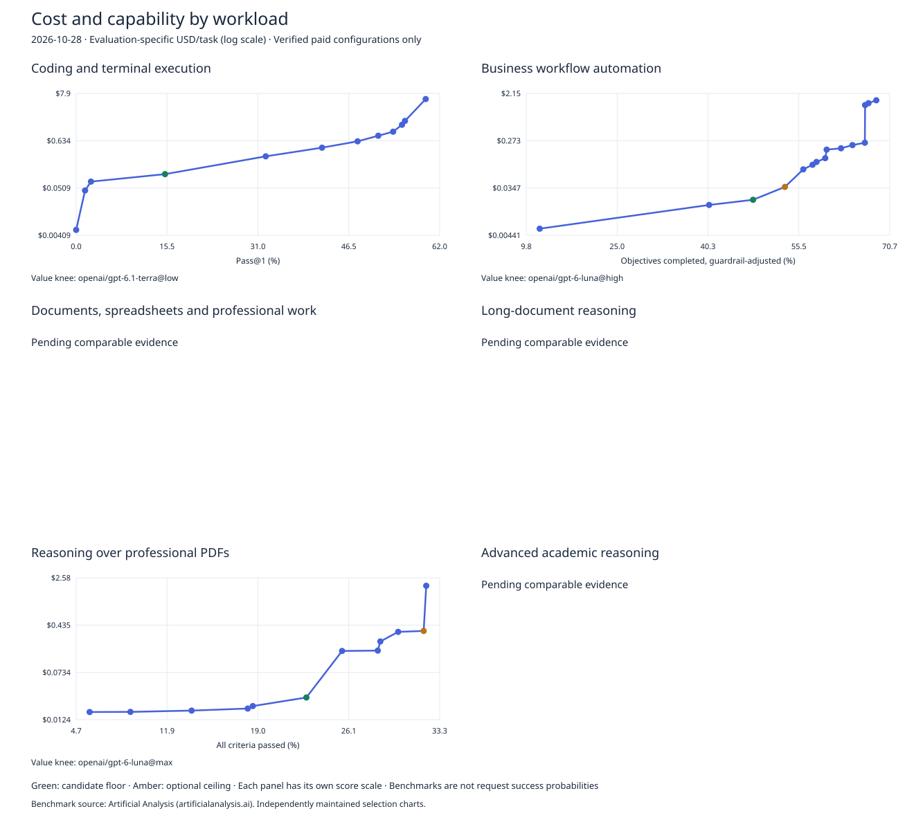

# Workload-specific model selection — 2026-10-28

Benchmark source: [Artificial Analysis](https://artificialanalysis.ai/). Original project code and documentation: [MIT](LICENSE). See [DATA-SOURCES.md](DATA-SOURCES.md) for attribution and the deferred data-rights review.

Each profile has its own benchmark score, measured evaluation task cost, harness and Pareto frontier. Scores and budgets are meaningful only within that profile. The general Intelligence Index remains in [latest.md](latest.md).

Screened **716 public AA configurations** and **456 OpenRouter entries**; acquired **273 active exact records**. Exact routing correspondence is incomplete. These are the best observed verified pairs, not proof of global optimality. All eligible configurations are reconsidered per workload, including those dominated in the general chart.

**Floor and ceiling are candidate value knees, not validated deployment defaults.** A cheap model scoring poorly can have an early cost knee. Supply a workload quality target or use a score/budget query; no application success threshold or calibrated Jev predictor has been supplied. Close score gaps may reflect evaluation noise. Dollars per score point are descriptive, and Elo/benchmark intervals need not have equal practical value.

Source checks completed at 2026-10-28T18:22:23.049499+00:00. Routing evidence expires after 48 hours. Missing or mismatched configurations fail without a substitute.



## Candidate floor and ceiling by workload

| Workload | Benchmark and score unit | Candidate floor | Optional ceiling |
|---|---|---|---|
| [Coding and terminal execution](#coding-terminal) | Terminal-Bench 4.0; pass_at_1_percent | `openai/gpt-6.1-terra / {"effort":"low"}`; 15.152; $0.106601/task | `openai/gpt-6.1-terra / {"effort":"low"}`; 15.152; $0.106601/task |
| [Business workflow automation](#business-automation) | AutomationBench-AA AA-II-4.3.2; guardrail_adjusted_objective_completion_percent | `openai/gpt-6-luna / {"effort":"high"}`; 47.824; $0.020750/task | `openai/gpt-6-luna / {"effort":"max"}`; 53.168; $0.036400/task |
| [Documents, spreadsheets and professional work](#professional-work) | GDPval-AA 2.1; elo | No clear knee; supply a score or budget | No clear knee; supply a score or budget |
| [Long-document reasoning](#long-context) | AA-LCR 1.1; pass_at_1_percent | No clear knee; supply a score or budget | No clear knee; supply a score or budget |
| [Reasoning over professional PDFs](#document-reasoning) | GDP.pdf (AA implementation) AA-II-4.3.2; all_criteria_pass_percent | `openai/gpt-6-luna / {"effort":"max"}`; 22.800; $0.028547/task | `openai/gpt-6.1-sol / {"effort":"high"}`; 32.000; $0.349401/task |
| [Advanced academic reasoning](#academic-reasoning) | Humanity's Last Exam (AA text subset) May-2025-text-2158/AA-II-4.3.2; pass_at_1_percent | No clear knee; supply a score or budget | No clear knee; supply a score or budget |

## coding-terminal

**Coding and terminal execution** — [Terminal-Bench](https://artificialanalysis.ai/evaluations/terminalbench-4-0), version `4.0`; score unit `pass_at_1_percent`; status `ready`.

Harness `aa-mini-swe-agent-terminalbench-4.0`: AA mini-swe-agent; 66 tasks, three repeats, 500-step limit, full transcript, upstream task timeouts.

Terminal execution is not the same as repository implementation, code review or an IDE coding agent.

AA evaluation-specific costPerTask from observed contestant token use and published prices; excludes unreported tools, judges, infrastructure and supervision. Not Intelligence Index weighted cost or an OpenRouter invoice estimate.

Verified candidates: 25; paid frontier: 12. Incomplete routing matches are retained as pending in workloads.json.

### Minimum cost for a minimum benchmark score

| Minimum-score interval | request.model | request.reasoning | Score | USD / this benchmark task |
|---|---|---|---:|---:|
| (−∞, 0] | `openai/gpt-6-luna` | `{"effort":"low"}` | 0.000 | $0.005448 |
| (0, 1.51515151515152] | `openai/gpt-6-luna` | `{"effort":"none"}` | 1.515 | $0.044621 |
| (1.51515151515152, 2.52525252525253] | `openai/gpt-6-luna` | `{"effort":"medium"}` | 2.525 | $0.071565 |
| (2.52525252525253, 15.151515151515198] | `openai/gpt-6.1-terra` | `{"effort":"low"}` | 15.152 | $0.106601 |
| (15.151515151515198, 32.3232323232323] | `openai/gpt-6.1-terra` | `{"effort":"medium"}` | 32.323 | $0.275657 |
| (32.3232323232323, 41.9191919191919] | `openai/gpt-6.1-terra` | `{"effort":"high"}` | 41.919 | $0.437542 |
| (41.9191919191919, 47.979797979798] | `openai/gpt-6.1-sol` | `{"effort":"medium"}` | 47.980 | $0.613755 |
| (47.979797979798, 51.5151515151515] | `openai/gpt-6.1-sol` | `{"effort":"high"}` | 51.515 | $0.828177 |
| (51.5151515151515, 54.040404040404] | `openai/gpt-6.1-sol` | `{"effort":"xhigh"}` | 54.040 | $1.025949 |
| (54.040404040404, 55.5555555555556] | `openai/gpt-6.1-terra` | `{"effort":"max"}` | 55.556 | $1.485313 |
| (55.5555555555556, 56.0606060606061] | `openai/gpt-6.1-sol` | `{"effort":"max"}` | 56.061 | $1.822763 |
| (56.0606060606061, 59.5959595959596] | `openai/gpt-6-astra` | `{"effort":"xhigh"}` | 59.596 | $5.855483 |

The first lower bound is unbounded for lookup only; it does not give score zero a practical meaning. No verified configuration satisfies a score above the last row.

### Maximum score within a benchmark-task budget

| Budget interval, USD | request.model | request.reasoning | Score |
|---|---|---|---:|
| [0.005448337009257049, 0.0446207812657598) | `openai/gpt-6-luna` | `{"effort":"low"}` | 0.000 |
| [0.0446207812657598, 0.07156543103673528) | `openai/gpt-6-luna` | `{"effort":"none"}` | 1.515 |
| [0.07156543103673528, 0.1066009786508095) | `openai/gpt-6-luna` | `{"effort":"medium"}` | 2.525 |
| [0.1066009786508095, 0.275657091680196) | `openai/gpt-6.1-terra` | `{"effort":"low"}` | 15.152 |
| [0.275657091680196, 0.4375420474275898) | `openai/gpt-6.1-terra` | `{"effort":"medium"}` | 32.323 |
| [0.4375420474275898, 0.6137554705459501) | `openai/gpt-6.1-terra` | `{"effort":"high"}` | 41.919 |
| [0.6137554705459501, 0.8281767981765117) | `openai/gpt-6.1-sol` | `{"effort":"medium"}` | 47.980 |
| [0.8281767981765117, 1.0259491542428139) | `openai/gpt-6.1-sol` | `{"effort":"high"}` | 51.515 |
| [1.0259491542428139, 1.4853125323157166) | `openai/gpt-6.1-sol` | `{"effort":"xhigh"}` | 54.040 |
| [1.4853125323157166, 1.8227634618325743) | `openai/gpt-6.1-terra` | `{"effort":"max"}` | 55.556 |
| [1.8227634618325743, 5.855482520522051) | `openai/gpt-6.1-sol` | `{"effort":"max"}` | 56.061 |
| [5.855482520522051, ∞) | `openai/gpt-6-astra` | `{"effort":"xhigh"}` | 59.596 |

### Marginal upgrades

| Upgrade to | Score gain | Added USD/task | Cost increase | USD / added score point | Marginal rate multiple |
|---|---:|---:|---:|---:|---:|
| `openai/gpt-6-luna / {"effort":"none"}` | 1.515152 | $0.039172 | 718.98% | $0.025854 | — |
| `openai/gpt-6-luna / {"effort":"medium"}` | 1.010101 | $0.026945 | 60.39% | $0.026675 | 1.03× |
| `openai/gpt-6.1-terra / {"effort":"low"}` | 12.626263 | $0.035036 | 48.96% | $0.002775 | 0.10× |
| `openai/gpt-6.1-terra / {"effort":"medium"}` | 17.171717 | $0.169056 | 158.59% | $0.009845 | 3.55× |
| `openai/gpt-6.1-terra / {"effort":"high"}` | 9.595960 | $0.161885 | 58.73% | $0.016870 | 1.71× |
| `openai/gpt-6.1-sol / {"effort":"medium"}` | 6.060606 | $0.176213 | 40.27% | $0.029075 | 1.72× |
| `openai/gpt-6.1-sol / {"effort":"high"}` | 3.535354 | $0.214421 | 34.94% | $0.060651 | 2.09× |
| `openai/gpt-6.1-sol / {"effort":"xhigh"}` | 2.525253 | $0.197772 | 23.88% | $0.078318 | 1.29× |
| `openai/gpt-6.1-terra / {"effort":"max"}` | 1.515152 | $0.459363 | 44.77% | $0.303180 | 3.87× |
| `openai/gpt-6.1-sol / {"effort":"max"}` | 0.505051 | $0.337451 | 22.72% | $0.668153 | 2.20× |
| `openai/gpt-6-astra / {"effort":"xhigh"}` | 3.535354 | $4.032719 | 221.24% | $1.140683 | 1.71× |

**Candidate floor:** The next step adds 17.1717171717171 score points for $0.16905611302938647 (158.58776830103963%); marginal cost rises 3.5479955053663796x. Conditional on this benchmark, workload and verified subset; not a universal default.

**Candidate ceiling:** The next step adds 17.1717171717171 score points for $0.16905611302938647 (158.58776830103963%); marginal cost rises 3.5479955053663796x. Conditional on this benchmark, workload and verified subset; not a universal default.

Pending reasons: exact_revision_effort_provider_route_not_verified: 27, nonstandard_pricing_tier: 1, original_configuration_eligibility_not_verified: 9, missing_comparable_score_or_evaluation_task_cost: 209, multi_model_or_fallback_configuration: 10, native_control_source_not_reverified: 2.

## business-automation

**Business workflow automation** — [AutomationBench-AA](https://artificialanalysis.ai/evaluations/automationbench-aa), version `AA-II-4.3.2`; score unit `guardrail_adjusted_objective_completion_percent`; status `ready`.

Harness `aa-automationbench-ii-4.3.2`: AA simulated SaaS REST workflow environment; 657 tasks; guardrail-violating tasks score zero.

The headline score measures objective completion, not the percentage of fully completed workflows or a request's success probability.

AA evaluation-specific costPerTask from observed contestant token use and published prices; excludes unreported tools, judges, infrastructure and supervision. Not Intelligence Index weighted cost or an OpenRouter invoice estimate.

Verified candidates: 25; paid frontier: 15. Incomplete routing matches are retained as pending in workloads.json.

### Minimum cost for a minimum benchmark score

| Minimum-score interval | request.model | request.reasoning | Score | USD / this benchmark task |
|---|---|---|---:|---:|
| (−∞, 12.049187272690505] | `openai/gpt-6-luna` | `{"effort":"low"}` | 12.049 | $0.005878 |
| (12.049187272690505, 40.46136879135791] | `openai/gpt-6-luna` | `{"effort":"medium"}` | 40.461 | $0.016571 |
| (40.46136879135791, 47.82449139916615] | `openai/gpt-6-luna` | `{"effort":"high"}` | 47.824 | $0.020750 |
| (47.82449139916615, 53.16814034483175] | `openai/gpt-6-luna` | `{"effort":"max"}` | 53.168 | $0.036400 |
| (53.16814034483175, 56.24828754079192] | `openai/gpt-6.1-terra` | `{"effort":"low"}` | 56.248 | $0.078318 |
| (56.24828754079192, 57.80171778957812] | `openai/gpt-6.1-terra` | `{"effort":"medium"}` | 57.802 | $0.095672 |
| (57.80171778957812, 58.4605963496433] | `openai/gpt-6.1-terra` | `{"effort":"high"}` | 58.461 | $0.108165 |
| (58.4605963496433, 59.92855956353923] | `openai/gpt-6.1-terra` | `{"effort":"xhigh"}` | 59.929 | $0.127588 |
| (59.92855956353923, 60.167623272577266] | `openai/gpt-6.1-terra` | `{"effort":"max"}` | 60.168 | $0.185285 |
| (60.167623272577266, 62.573509704356866] | `openai/gpt-6.1-sol` | `{"effort":"medium"}` | 62.574 | $0.196304 |
| (62.573509704356866, 64.49523732184466] | `openai/gpt-6.1-sol` | `{"effort":"high"}` | 64.495 | $0.225781 |
| (64.49523732184466, 66.57372141364344] | `openai/gpt-6.1-sol` | `{"effort":"xhigh"}` | 66.574 | $0.250558 |
| (66.57372141364344, 66.6122174975011] | `openai/gpt-6-astra` | `{"effort":"high"}` | 66.612 | $1.295185 |
| (66.6122174975011, 67.17778020215393] | `openai/gpt-6-astra` | `{"effort":"xhigh"}` | 67.178 | $1.406389 |
| (67.17778020215393, 68.49174806688876] | `openai/gpt-6-astra` | `{"effort":"max"}` | 68.492 | $1.595592 |

The first lower bound is unbounded for lookup only; it does not give score zero a practical meaning. No verified configuration satisfies a score above the last row.

### Maximum score within a benchmark-task budget

| Budget interval, USD | request.model | request.reasoning | Score |
|---|---|---|---:|
| [0.005878499065985337, 0.01657116888405385) | `openai/gpt-6-luna` | `{"effort":"low"}` | 12.049 |
| [0.01657116888405385, 0.020749699267145254) | `openai/gpt-6-luna` | `{"effort":"medium"}` | 40.461 |
| [0.020749699267145254, 0.03639964442044852) | `openai/gpt-6-luna` | `{"effort":"high"}` | 47.824 |
| [0.03639964442044852, 0.07831828132992215) | `openai/gpt-6-luna` | `{"effort":"max"}` | 53.168 |
| [0.07831828132992215, 0.095672051788299) | `openai/gpt-6.1-terra` | `{"effort":"low"}` | 56.248 |
| [0.095672051788299, 0.10816495593633714) | `openai/gpt-6.1-terra` | `{"effort":"medium"}` | 57.802 |
| [0.10816495593633714, 0.12758763996683659) | `openai/gpt-6.1-terra` | `{"effort":"high"}` | 58.461 |
| [0.12758763996683659, 0.18528505343384066) | `openai/gpt-6.1-terra` | `{"effort":"xhigh"}` | 59.929 |
| [0.18528505343384066, 0.19630359332471714) | `openai/gpt-6.1-terra` | `{"effort":"max"}` | 60.168 |
| [0.19630359332471714, 0.22578054709230252) | `openai/gpt-6.1-sol` | `{"effort":"medium"}` | 62.574 |
| [0.22578054709230252, 0.2505578926118788) | `openai/gpt-6.1-sol` | `{"effort":"high"}` | 64.495 |
| [0.2505578926118788, 1.2951847697570744) | `openai/gpt-6.1-sol` | `{"effort":"xhigh"}` | 66.574 |
| [1.2951847697570744, 1.406388714811355) | `openai/gpt-6-astra` | `{"effort":"high"}` | 66.612 |
| [1.406388714811355, 1.5955923111377626) | `openai/gpt-6-astra` | `{"effort":"xhigh"}` | 67.178 |
| [1.5955923111377626, ∞) | `openai/gpt-6-astra` | `{"effort":"max"}` | 68.492 |

### Marginal upgrades

| Upgrade to | Score gain | Added USD/task | Cost increase | USD / added score point | Marginal rate multiple |
|---|---:|---:|---:|---:|---:|
| `openai/gpt-6-luna / {"effort":"medium"}` | 28.412182 | $0.010693 | 181.89% | $0.000376 | — |
| `openai/gpt-6-luna / {"effort":"high"}` | 7.363123 | $0.004179 | 25.22% | $0.000567 | 1.51× |
| `openai/gpt-6-luna / {"effort":"max"}` | 5.343649 | $0.015650 | 75.42% | $0.002929 | 5.16× |
| `openai/gpt-6.1-terra / {"effort":"low"}` | 3.080147 | $0.041919 | 115.16% | $0.013609 | 4.65× |
| `openai/gpt-6.1-terra / {"effort":"medium"}` | 1.553430 | $0.017354 | 22.16% | $0.011171 | 0.82× |
| `openai/gpt-6.1-terra / {"effort":"high"}` | 0.658879 | $0.012493 | 13.06% | $0.018961 | 1.70× |
| `openai/gpt-6.1-terra / {"effort":"xhigh"}` | 1.467963 | $0.019423 | 17.96% | $0.013231 | 0.70× |
| `openai/gpt-6.1-terra / {"effort":"max"}` | 0.239064 | $0.057697 | 45.22% | $0.241347 | 18.24× |
| `openai/gpt-6.1-sol / {"effort":"medium"}` | 2.405886 | $0.011019 | 5.95% | $0.004580 | 0.02× |
| `openai/gpt-6.1-sol / {"effort":"high"}` | 1.921728 | $0.029477 | 15.02% | $0.015339 | 3.35× |
| `openai/gpt-6.1-sol / {"effort":"xhigh"}` | 2.078484 | $0.024777 | 10.97% | $0.011921 | 0.78× |
| `openai/gpt-6-astra / {"effort":"high"}` | 0.038496 | $1.044627 | 416.92% | $27.135926 | 2276.34× |
| `openai/gpt-6-astra / {"effort":"xhigh"}` | 0.565563 | $0.111204 | 8.59% | $0.196625 | 0.01× |
| `openai/gpt-6-astra / {"effort":"max"}` | 1.313968 | $0.189204 | 13.45% | $0.143994 | 0.73× |

**Candidate floor:** The next step adds 5.343648945665599 score points for $0.015649945153303264 (75.42251553536074%); marginal cost rises 5.160756503913648x. Conditional on this benchmark, workload and verified subset; not a universal default.

**Candidate ceiling:** The next step adds 3.0801471959601727 score points for $0.04191863690947363 (115.16221539220494%); marginal cost rises 4.64687275081213x. Conditional on this benchmark, workload and verified subset; not a universal default.

Pending reasons: exact_revision_effort_provider_route_not_verified: 27, nonstandard_pricing_tier: 1, original_configuration_eligibility_not_verified: 9, missing_comparable_score_or_evaluation_task_cost: 209, multi_model_or_fallback_configuration: 10, native_control_source_not_reverified: 2.

## professional-work

**Documents, spreadsheets and professional work** — [GDPval-AA](https://artificialanalysis.ai/evaluations/gdpval-aa), version `2.1`; score unit `elo`; status `pending_verified_pairs`.

Harness `aa-stirrup-gdpval-2.1`: AA Stirrup with code execution, browsing and file outputs; 220 tasks; Crowd-BT Elo anchored to DeepSeek V4.1 Flash max at 1600.

Elo is a relative quality rating, not a percentage or an absolute success target. Benchmark contestant-token cost excludes infrastructure, supervision and external tool charges unless included by the source.

AA evaluation-specific costPerTask from observed contestant token use and published prices; excludes unreported tools, judges, infrastructure and supervision. Not Intelligence Index weighted cost or an OpenRouter invoice estimate.

Verified candidates: 0; paid frontier: 0. Incomplete routing matches are retained as pending in workloads.json.

### Minimum cost for a minimum benchmark score

| Minimum-score interval | request.model | request.reasoning | Score | USD / this benchmark task |
|---|---|---|---:|---:|

No exact score plus evaluation-specific costPerTask pair is published in the freshly acquired current model records. Legacy evaluation scores/token counts alone do not authorize retaining prior costs or borrowing the v5 weighted task cost.


The first lower bound is unbounded for lookup only; it does not give score zero a practical meaning. No verified configuration satisfies a score above the last row.

### Maximum score within a benchmark-task budget

| Budget interval, USD | request.model | request.reasoning | Score |
|---|---|---|---:|

### Marginal upgrades

| Upgrade to | Score gain | Added USD/task | Cost increase | USD / added score point | Marginal rate multiple |
|---|---:|---:|---:|---:|---:|

Pending reasons: missing_comparable_score_or_evaluation_task_cost: 283.

## long-context

**Long-document reasoning** — [AA-LCR](https://artificialanalysis.ai/evaluations/artificial-analysis-long-context-reasoning), version `1.1`; score unit `pass_at_1_percent`; status `pending_verified_pairs`.

Harness `aa-lcr-1.1`: AA-LCR v1.1; 100 text questions, three repeats; approximately 100K-token supplied contexts; equality-checker grading.

Applies to supplied long text, not live retrieval, arbitrary context lengths or all PDF input formats.

AA evaluation-specific costPerTask from observed contestant token use and published prices; excludes unreported tools, judges, infrastructure and supervision. Not Intelligence Index weighted cost or an OpenRouter invoice estimate.

Verified candidates: 0; paid frontier: 0. Incomplete routing matches are retained as pending in workloads.json.

### Minimum cost for a minimum benchmark score

| Minimum-score interval | request.model | request.reasoning | Score | USD / this benchmark task |
|---|---|---|---:|---:|

No exact score plus evaluation-specific costPerTask pair is published in the freshly acquired current model records. Legacy evaluation scores/token counts alone do not authorize retaining prior costs or borrowing the v5 weighted task cost.


The first lower bound is unbounded for lookup only; it does not give score zero a practical meaning. No verified configuration satisfies a score above the last row.

### Maximum score within a benchmark-task budget

| Budget interval, USD | request.model | request.reasoning | Score |
|---|---|---|---:|

### Marginal upgrades

| Upgrade to | Score gain | Added USD/task | Cost increase | USD / added score point | Marginal rate multiple |
|---|---:|---:|---:|---:|---:|

Pending reasons: missing_comparable_score_or_evaluation_task_cost: 283.

## document-reasoning

**Reasoning over professional PDFs** — [GDP.pdf (AA implementation)](https://artificialanalysis.ai/evaluations/gdp-pdf), version `AA-II-4.3.2`; score unit `all_criteria_pass_percent`; status `ready`.

Harness `aa-gdp-pdf-ii-4.3.2`: AA LiteParse/OCR text, plus page images for image-capable models; 100 tasks, five repeats; all-criteria-pass grading.

AA and Surge use different input preparation and judges. Cost excludes document preparation, OCR and judge calls. Page-image capability must be checked for an image-dependent application.

AA evaluation-specific costPerTask from observed contestant token use and published prices; excludes unreported tools, judges, infrastructure and supervision. Not Intelligence Index weighted cost or an OpenRouter invoice estimate.

Verified candidates: 25; paid frontier: 12. Incomplete routing matches are retained as pending in workloads.json.

### Minimum cost for a minimum benchmark score

| Minimum-score interval | request.model | request.reasoning | Score | USD / this benchmark task |
|---|---|---|---:|---:|
| (−∞, 5.800000000000001] | `openai/gpt-6-luna` | `{"effort":"none"}` | 5.800 | $0.016515 |
| (5.800000000000001, 9.0] | `openai/gpt-6-luna` | `{"effort":"low"}` | 9.000 | $0.016602 |
| (9.0, 13.8] | `openai/gpt-6-luna` | `{"effort":"medium"}` | 13.800 | $0.017432 |
| (13.8, 18.2] | `openai/gpt-6-luna` | `{"effort":"high"}` | 18.200 | $0.018825 |
| (18.2, 18.6] | `openai/gpt-6-luna` | `{"effort":"xhigh"}` | 18.600 | $0.020664 |
| (18.6, 22.8] | `openai/gpt-6-luna` | `{"effort":"max"}` | 22.800 | $0.028547 |
| (22.8, 25.6] | `openai/gpt-6.1-terra` | `{"effort":"low"}` | 25.600 | $0.164403 |
| (25.6, 28.4] | `openai/gpt-6.1-terra` | `{"effort":"medium"}` | 28.400 | $0.166710 |
| (28.4, 28.599999999999998] | `openai/gpt-6.1-terra` | `{"effort":"max"}` | 28.600 | $0.235180 |
| (28.599999999999998, 30.0] | `openai/gpt-6.1-sol` | `{"effort":"medium"}` | 30.000 | $0.337478 |
| (30.0, 32.0] | `openai/gpt-6.1-sol` | `{"effort":"high"}` | 32.000 | $0.349401 |
| (32.0, 32.2] | `openai/gpt-6-astra` | `{"effort":"xhigh"}` | 32.200 | $1.912723 |

The first lower bound is unbounded for lookup only; it does not give score zero a practical meaning. No verified configuration satisfies a score above the last row.

### Maximum score within a benchmark-task budget

| Budget interval, USD | request.model | request.reasoning | Score |
|---|---|---|---:|
| [0.016514747, 0.016602051000000003) | `openai/gpt-6-luna` | `{"effort":"none"}` | 5.800 |
| [0.016602051000000003, 0.017431547000000002) | `openai/gpt-6-luna` | `{"effort":"low"}` | 9.000 |
| [0.017431547000000002, 0.018825166) | `openai/gpt-6-luna` | `{"effort":"medium"}` | 13.800 |
| [0.018825166, 0.020663617) | `openai/gpt-6-luna` | `{"effort":"high"}` | 18.200 |
| [0.020663617, 0.028547064) | `openai/gpt-6-luna` | `{"effort":"xhigh"}` | 18.600 |
| [0.028547064, 0.16440301999999998) | `openai/gpt-6-luna` | `{"effort":"max"}` | 22.800 |
| [0.16440301999999998, 0.16670952) | `openai/gpt-6.1-terra` | `{"effort":"low"}` | 25.600 |
| [0.16670952, 0.23517992) | `openai/gpt-6.1-terra` | `{"effort":"medium"}` | 28.400 |
| [0.23517992, 0.33747823999999993) | `openai/gpt-6.1-terra` | `{"effort":"max"}` | 28.600 |
| [0.33747823999999993, 0.34940143999999995) | `openai/gpt-6.1-sol` | `{"effort":"medium"}` | 30.000 |
| [0.34940143999999995, 1.9127230999999998) | `openai/gpt-6.1-sol` | `{"effort":"high"}` | 32.000 |
| [1.9127230999999998, ∞) | `openai/gpt-6-astra` | `{"effort":"xhigh"}` | 32.200 |

### Marginal upgrades

| Upgrade to | Score gain | Added USD/task | Cost increase | USD / added score point | Marginal rate multiple |
|---|---:|---:|---:|---:|---:|
| `openai/gpt-6-luna / {"effort":"low"}` | 3.200000 | $0.000087 | 0.53% | $0.000027 | — |
| `openai/gpt-6-luna / {"effort":"medium"}` | 4.800000 | $0.000829 | 5.00% | $0.000173 | 6.33× |
| `openai/gpt-6-luna / {"effort":"high"}` | 4.400000 | $0.001394 | 7.99% | $0.000317 | 1.83× |
| `openai/gpt-6-luna / {"effort":"xhigh"}` | 0.400000 | $0.001838 | 9.77% | $0.004596 | 14.51× |
| `openai/gpt-6-luna / {"effort":"max"}` | 4.200000 | $0.007883 | 38.15% | $0.001877 | 0.41× |
| `openai/gpt-6.1-terra / {"effort":"low"}` | 2.800000 | $0.135856 | 475.90% | $0.048520 | 25.85× |
| `openai/gpt-6.1-terra / {"effort":"medium"}` | 2.800000 | $0.002307 | 1.40% | $0.000824 | 0.02× |
| `openai/gpt-6.1-terra / {"effort":"max"}` | 0.200000 | $0.068470 | 41.07% | $0.342352 | 415.60× |
| `openai/gpt-6.1-sol / {"effort":"medium"}` | 1.400000 | $0.102298 | 43.50% | $0.073070 | 0.21× |
| `openai/gpt-6.1-sol / {"effort":"high"}` | 2.000000 | $0.011923 | 3.53% | $0.005962 | 0.08× |
| `openai/gpt-6-astra / {"effort":"xhigh"}` | 0.200000 | $1.563322 | 447.43% | $7.816608 | 1311.16× |

**Candidate floor:** The next step adds 2.8000000000000007 score points for $0.13585595599999997 (475.9016759131516%); marginal cost rises 25.849597771127254x. Conditional on this benchmark, workload and verified subset; not a universal default.

**Candidate ceiling:** The next step adds 0.20000000000000284 score points for $1.5633216599999997 (447.42851088421384%); marginal cost rises 1311.159470611895x. Conditional on this benchmark, workload and verified subset; not a universal default.

Pending reasons: exact_revision_effort_provider_route_not_verified: 27, nonstandard_pricing_tier: 1, original_configuration_eligibility_not_verified: 9, missing_comparable_score_or_evaluation_task_cost: 209, multi_model_or_fallback_configuration: 10, native_control_source_not_reverified: 2.

## academic-reasoning

**Advanced academic reasoning** — [Humanity's Last Exam (AA text subset)](https://artificialanalysis.ai/evaluations/humanitys-last-exam), version `May-2025-text-2158/AA-II-4.3.2`; score unit `pass_at_1_percent`; status `pending_verified_pairs`.

Harness `aa-hle-text-2158-ii-4.3.2`: AA 2,158-question text-only May 2025 subset; one repeat; no browsing or code tools; equality-checker grading.

Includes mathematics, science and humanities. It is not a direct measure of research-agent performance or a calibrated probability for a new question.

AA evaluation-specific costPerTask from observed contestant token use and published prices; excludes unreported tools, judges, infrastructure and supervision. Not Intelligence Index weighted cost or an OpenRouter invoice estimate.

Verified candidates: 0; paid frontier: 0. Incomplete routing matches are retained as pending in workloads.json.

### Minimum cost for a minimum benchmark score

| Minimum-score interval | request.model | request.reasoning | Score | USD / this benchmark task |
|---|---|---|---:|---:|

No exact score plus evaluation-specific costPerTask pair is published in the freshly acquired current model records. Legacy evaluation scores/token counts alone do not authorize retaining prior costs or borrowing the v5 weighted task cost.


The first lower bound is unbounded for lookup only; it does not give score zero a practical meaning. No verified configuration satisfies a score above the last row.

### Maximum score within a benchmark-task budget

| Budget interval, USD | request.model | request.reasoning | Score |
|---|---|---|---:|

### Marginal upgrades

| Upgrade to | Score gain | Added USD/task | Cost increase | USD / added score point | Marginal rate multiple |
|---|---:|---:|---:|---:|---:|

Pending reasons: missing_comparable_score_or_evaluation_task_cost: 283.

## Exact API routing

Every actionable row pins one standard provider, uses `require_parameters:true` and `allow_fallbacks:false`, and carries exact canonical revision, reasoning control, source timestamps and endpoint parameters. Missing revisions, controls or freshness are rejected. Provider token prices are separate from the task-cost measurements. No automatic/latest aliases or fallback-system scores are used.

| Callable model | Canonical revision | provider.only | API surface |
|---|---|---|---|
| `openai/gpt-6-luna` | `openai/gpt-6-luna-20260922` | `openai` | `https://openrouter.ai/api/v1/responses` |
| `openai/gpt-6.1-terra` | `openai/gpt-6.1-terra-20261026` | `openai` | `https://openrouter.ai/api/v1/responses` |
| `openai/gpt-6.1-sol` | `openai/gpt-6.1-sol-20260929` | `openai` | `https://openrouter.ai/api/v1/responses` |
| `openai/gpt-6-astra` | `openai/gpt-6-astra-20260903` | `openai` | `https://openrouter.ai/api/v1/responses` |

## Complete coding-agent systems

These are separate model-plus-agent evaluations from the AA Coding Agent Index. They are useful evidence when building with a coding service, conditional on exact client version, settings and account access. API task costs below are for the tested system; subscription cost per prompt remains null. They do not authorize a standalone OpenRouter request. Fallback counts and tested harness versions are retained in workloads.json.

| Tested agent/system | Coding Agent Index score | API USD / agent task | Fallback attempts |
|---|---:|---:|---:|
| Codex - GPT-6 Luna (Max) | 31.126 | $0.159156 | 0 |
| Codex - GPT-6.1 Terra (Low) | 34.857 | $0.198820 | 0 |
| DeepSeek Harness - DeepSeek V4.1 Flash 1017 (Max) | 46.305 | $0.296275 | 0 |
| Codex - DeepSeek V4.1 Flash (Max) | 47.300 | $0.386194 | 0 |
| Codex - GPT-6.1 Terra (Xhigh) | 48.224 | $0.690844 | 0 |
| Codex - GPT-6.1 Sol (Max) | 54.128 | $1.504639 | 0 |
| GitHub Copilot - Copilot Fusion (Max) | 59.857 | $5.587385 | 0 |
| Devin Fusion CLI - Claude Opus 5.5 Max + GPT-6 Luna High | 61.512 | $7.997688 | 0 |
| Claude Code - Claude Opus 5.5 (Max, Default Fallback) | 61.653 | $11.422720 | 76 |

Coding Agent Index version `2.0`; [original results](https://artificialanalysis.ai/agents/coding-agents) and [methodology](https://artificialanalysis.ai/methodology/coding-agents-benchmarking). Systems with missing cost, unverified tiered costs or unavailable access are listed separately in workloads.json. A tested fallback chain stays part of that system; it is never silently represented as one model.

## Pending workload profiles

| Workload | Candidate evidence | Missing requirement |
|---|---|---|
| Repository implementation and bug fixes | FrontierCode v1.1 | Separate common-harness configuration-level score and task-cost extraction remains required. Coding-agent system results are reported separately, never borrowed as API model scores. |
| Scientific coding | SciCode | The maintained general report flags SciCode as under review. Resolve the evaluation warning before enabling a dedicated routing frontier. |
| Physics reasoning | CritPt | The maintained general report flags CritPt as under review. Resolve the evaluation warning before enabling a dedicated routing frontier. |
| Live web research and retrieval | Cross-model research evaluation | AA Search Index holds the answer model fixed to compare search providers. It cannot establish a cross-model research frontier. Matching model-plus-search evaluations and all tool charges are required. |
| Structured extraction and classification | Application-specific held-out tasks | Requires representative labeled examples, schema validation and measured attempts, retries and tool costs. No production task data or calibrated Jev predictions have been supplied. |

## Router and Jev integration

The selector accepts a workload plus a benchmark score or benchmark-task budget. It filters every verified candidate before recomputing dominance for required parameters, input modality and context length. An unknown workload or unsupported constraint is rejected. A removed live endpoint is rejected rather than replaced with another model.

```sh
node select-workload.mjs workloads.json business_automation score:60 tools
node select-workload.mjs workloads.json coding_terminal budget:1 tools
node select-workload.mjs workloads.json long_context score:80 "" --min-context=128000
node select-workload.mjs workloads.json long_context budget:0 "" --allow-limited-free
```

```js
import {buildWorkloadSelection} from './select-workload.mjs';
const selected = await buildWorkloadSelection('workloads.json', 'business_automation',
  {max_task_cost_usd: 0.05}, {required_parameters: ['tools']});
// Send selected.request with task input, tools and sufficient output budget.
```

Jev is not integrated or calibrated by this refresh. A future predictor should estimate success for the task, workload, model revision, reasoning setting and execution setup, and be calibrated on held-out accepted outcomes. No benchmark-to-probability conversion is valid by assumption. Track attempted cost, retries, tools, verification, acceptance and latency without publishing private task content. Production evaluation runs and generation charges require a separate configured evaluation service; this public-data pipeline makes no paid calls.

## Sources

- https://artificialanalysis.ai/agents/coding-agents
- https://artificialanalysis.ai/evaluations/artificial-analysis-long-context-reasoning
- https://artificialanalysis.ai/evaluations/automationbench-aa
- https://artificialanalysis.ai/evaluations/gdp-pdf
- https://artificialanalysis.ai/evaluations/gdpval-aa
- https://artificialanalysis.ai/evaluations/humanitys-last-exam
- https://artificialanalysis.ai/evaluations/terminalbench-4-0
- https://artificialanalysis.ai/methodology/coding-agents-benchmarking
- https://artificialanalysis.ai/methodology/intelligence-benchmarking
